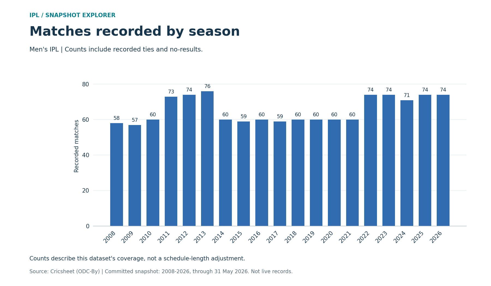
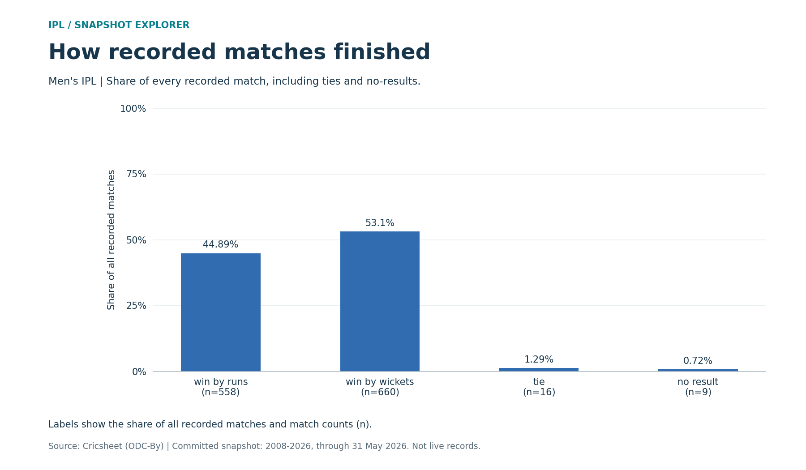
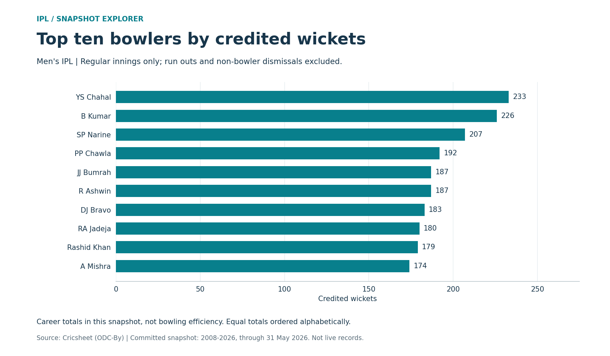
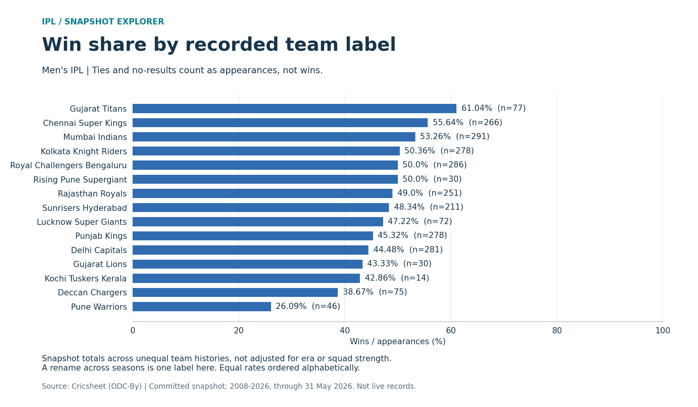
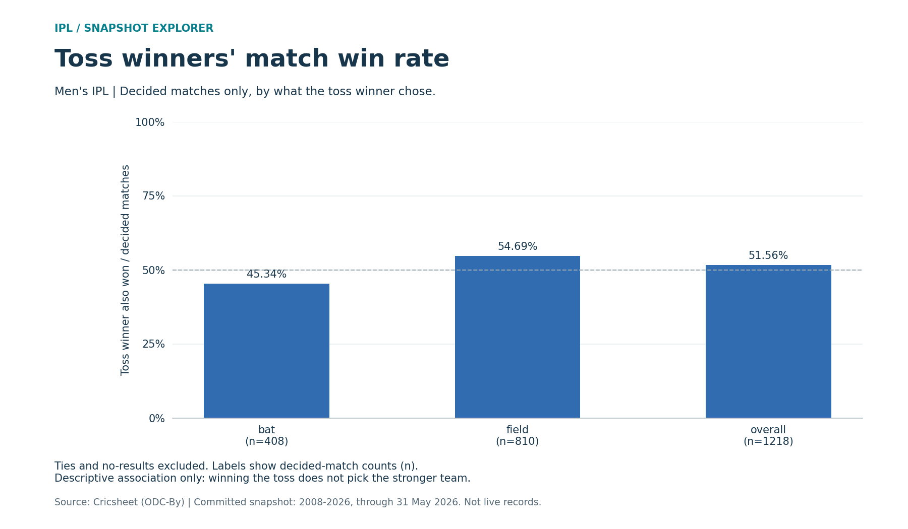
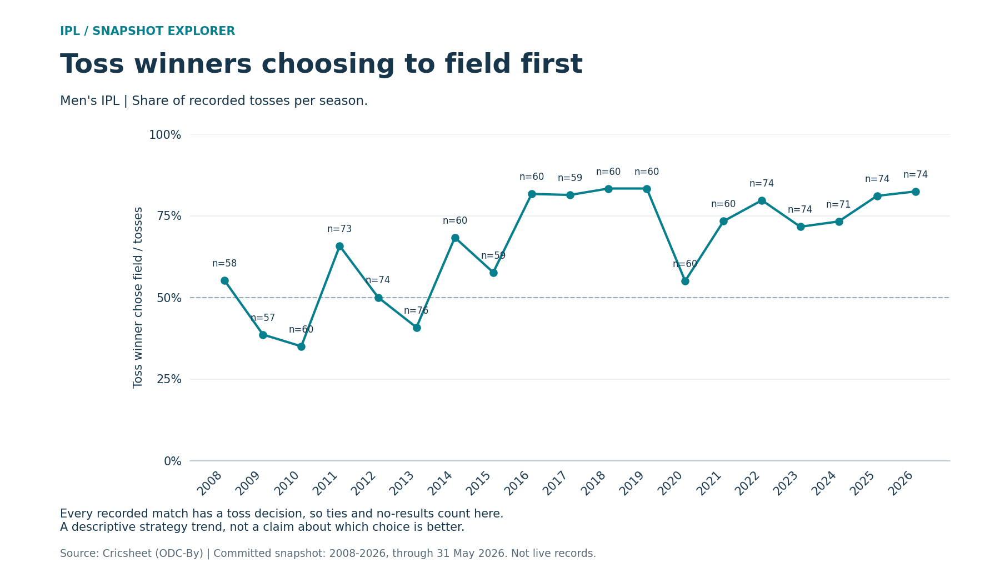
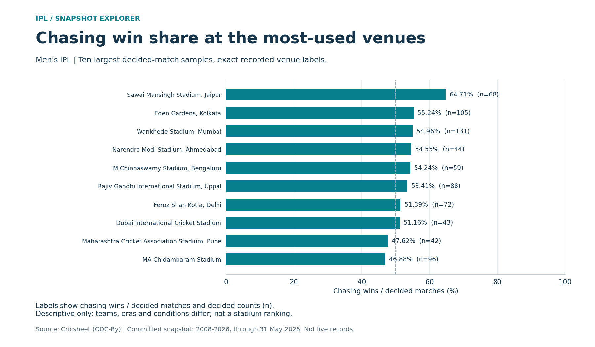
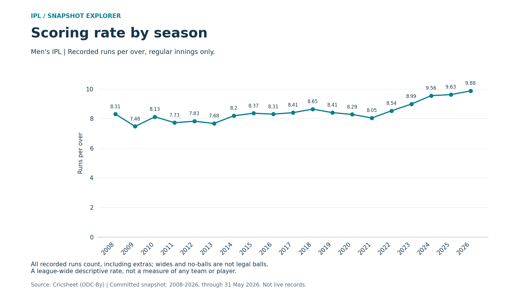

# Chart gallery

Ten descriptive charts from the committed Cricsheet snapshot (2008-2026,
through 31 May 2026). These are snapshot totals, not live IPL records.
Contains information from [Cricsheet](https://cricsheet.org/), made available
under the [ODC Attribution License](https://opendatacommons.org/licenses/by/1-0/).

## Reproduce

From the repository root, after installing `requirements.txt`:

```bash
python src/plot_analysis.py
python -m pytest -q
```

The script also works from another working directory. It reads only the
committed `data/processed/` CSVs, validates them with the existing analysis
functions and writes ten PNG files under `figures/`. It performs no downloads
and does not modify the dataset or existing result tables. No new dependencies.
The Agg canvas supports machines without a desktop/display.

## Matches by season



All recorded outcomes count, including ties and no-results. This describes
snapshot coverage, not an adjustment for different season lengths. The highest
count here is 76 in 2013. See [first-analysis methods](first-analysis.md).

## How recorded matches finished



Shares use all 1,243 recorded matches as the denominator, so ties and
no-results stay visible. A win by wickets is a chasing win; a win by runs is
a defending win. See [first-analysis methods](first-analysis.md).

## Top ten batters


Regular innings only, with extras and Super Overs excluded. V Kohli leads
this snapshot with 9,336 bat runs. Total runs are not a measure of scoring
rate or a fair comparison of players with different career lengths.
Equal totals use alphabetical ordering. See [first-analysis methods](first-analysis.md).

## Top ten bowlers



Only bowler-credited dismissals in regular innings count. Run outs and other
non-bowler dismissals do not count. YS Chahal leads this snapshot with 233.
This is not an economy-rate or bowling-average comparison. JJ Bumrah and
R Ashwin both have 187; their ordering is alphabetical, not a performance
ranking between tied totals. See [bowling methods](bowling-analysis.md).

## Win share by recorded team label



Ties and no-results count as appearances, not wins. Team histories in this
snapshot are unequal, and a rename across seasons is one label here, so this
ranks snapshot records rather than franchise quality. Labels show the win
share and appearances (n). See [team and toss methods](team-and-toss-analysis.md).

## Toss winners' match win rate



Decided matches only, split by what the toss winner chose. The dashed line is
50%. Labels show decided-match counts (n). Descriptive association only:
winning the toss does not pick the stronger team. See
[team and toss methods](team-and-toss-analysis.md).

## Toss winners choosing to field first



Share of recorded tosses per season. Every recorded match has a toss
decision, so ties and no-results count here. Labels show recorded match
counts (n). A descriptive strategy trend, not a claim about which choice is
better. See [team and toss methods](team-and-toss-analysis.md).

## Chasing win share by season


The numerator is recorded wins by wickets. The denominator is recorded wins
by wickets plus wins by runs, excluding ties and no-results. D/L results are
retained. Each point's label gives its decided-match sample size, `n`.
The dashed reference is 50%, and the vertical scale runs from 0% to 100%.
A season with no decided matches would appear as a gap, never a 0% rate.
Rates are calculated from counts, without rounding before plotting.

This is descriptive. It does not prove that choosing to chase causes a higher
win probability; teams, venues and conditions differ across seasons.
See [venue/chasing methods](venue-and-chasing-analysis.md).

## Chasing win share at the most-used venues



The ten largest decided-match samples, using exact recorded venue labels;
spellings, city suffixes and historical names are not combined. Labels show
chasing wins / decided matches and decided counts (n). The dashed reference
is 50%. Descriptive only: teams, eras and conditions differ, so this is not a
stadium ranking. See [venue/chasing methods](venue-and-chasing-analysis.md).

## Scoring rate by season



All recorded runs count, including extras; wides and no-balls are not legal
balls, so they are excluded from the ball count, matching how an over
progresses. Super Overs are excluded. A league-wide descriptive rate, not a
measure of any team or player.

## Checks

The chart tests compare all ten input tables with the committed, independently
audited CSV outputs. They also check the plotted bar heights/widths, ranking
labels, zero baselines, season coverage, chasing denominator, venue sample
selection, reference lines, undefined-rate gaps and repeatable, nonempty PNG
generation in the same environment. Existing analysis tests still run
unchanged. PNG bytes can differ between Matplotlib/font versions, so byte
identity is only checked within one run. The chart gallery has been visually
checked for readable labels and clipping.

The closing summary of measured findings is in
[final findings](final-findings.md).
