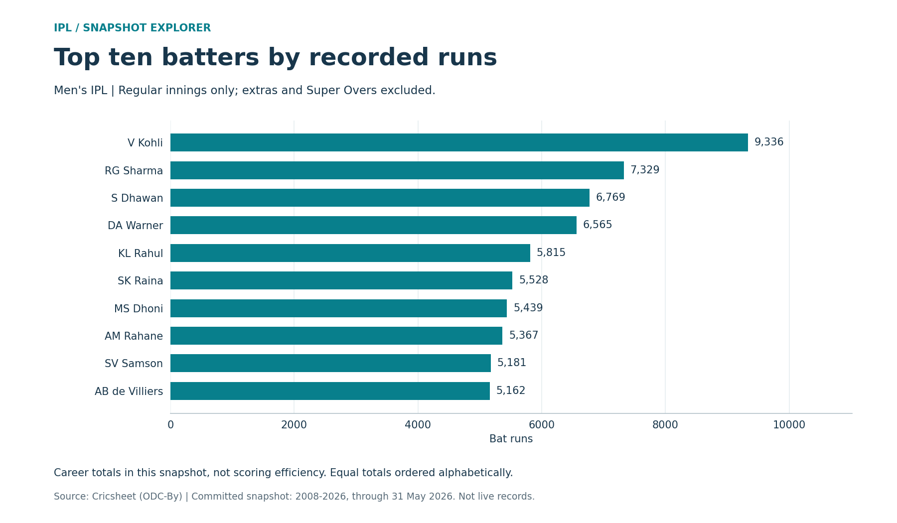
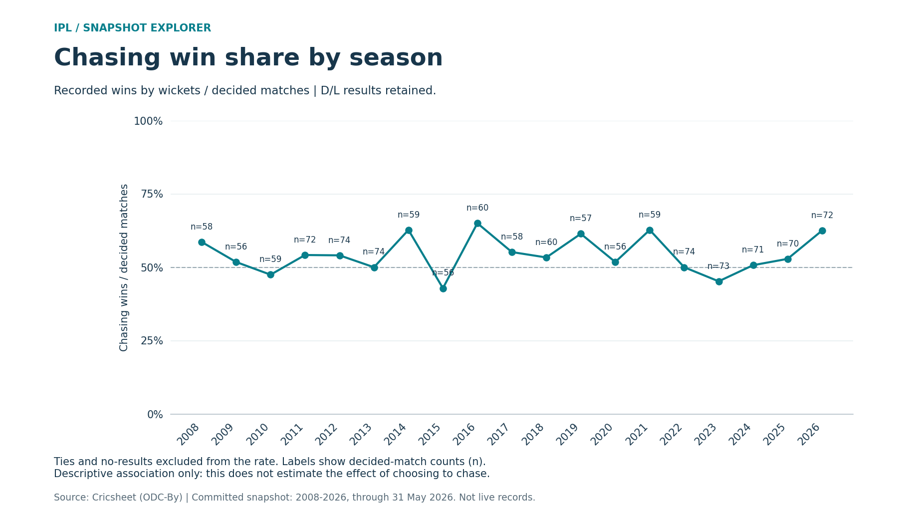

# First chart gallery

Four descriptive charts from the committed Cricsheet snapshot (2008-2026,
through 31 May 2026). These are snapshot totals, not live IPL records.
Contains information from [Cricsheet](https://cricsheet.org/), made available
under the [ODC Attribution License](https://opendatacommons.org/licenses/by/1-0/).

## Reproduce

From the repository root, after installing `requirements.txt`:

```bash
python src/plot_analysis.py
python -m pytest -q
```

The script also works from another working directory. It reads only the
committed `data/processed/` CSVs, validates them with the existing analysis
functions and writes four PNG files under `figures/`. It performs no downloads
and does not modify the dataset or existing result tables. No new dependencies.
The Agg canvas supports machines without a desktop/display.

## Matches by season


All recorded outcomes count, including ties and no-results. This describes
snapshot coverage, not an adjustment for different season lengths. The highest
count here is 76 in 2013. See [first-analysis methods](first-analysis.md).

## Top ten batters



Regular innings only, with extras and Super Overs excluded. V Kohli leads
this snapshot with 9,336 bat runs. Total runs are not a measure of scoring
rate or a fair comparison of players with different career lengths.
Equal totals use alphabetical ordering. See [first-analysis methods](first-analysis.md).

## Top ten bowlers


Only bowler-credited dismissals in regular innings count. Run outs and other
non-bowler dismissals do not count. YS Chahal leads this snapshot with 233.
This is not an economy-rate or bowling-average comparison. JJ Bumrah and
R Ashwin both have 187; their ordering is alphabetical, not a performance
ranking between tied totals. See [bowling methods](bowling-analysis.md).

## Chasing share by season



The numerator is recorded wins by wickets. The denominator is recorded wins
by wickets plus wins by runs, excluding ties and no-results. D/L results are
retained. Each point's label gives its decided-match sample size, `n`.
The dashed reference is 50%, and the vertical scale runs from 0% to 100%.
A season with no decided matches would appear as a gap, never a 0% rate.
Rates are calculated from counts, without rounding before plotting.

This is descriptive. It does not prove that choosing to chase causes a higher
win probability; teams, venues and conditions differ across seasons.
See [venue/chasing methods](venue-and-chasing-analysis.md).

## Checks

The chart tests compare all four input tables with the committed, independently
audited CSV outputs. They also check the plotted bar heights/widths, ranking
labels, zero baselines, season coverage, chasing denominator, undefined-rate
gaps and repeatable, nonempty PNG generation in the same environment.
Existing analysis tests still run unchanged. PNG bytes can differ between
Matplotlib/font versions, so byte identity is only checked within one run.
The chart gallery has been visually checked for readable labels and clipping.

This is the first visualization increment, not the completed final report.
Remaining work includes further focused charts and a final findings write-up.
